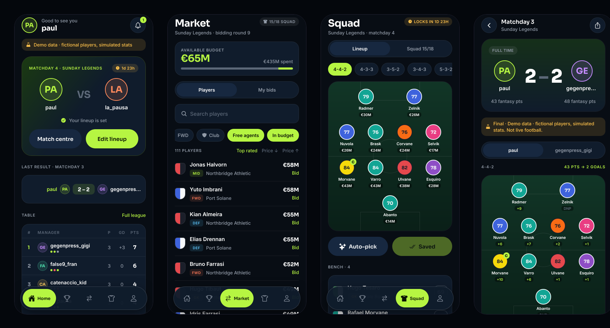

# Rondo — social fantasy football

Private leagues with friends, a €500M blind-auction transfer market, and one
head-to-head rival every matchday. Free to play: virtual budgets only, no
betting, no cash prizes. "Rondo" is a working name (run a trademark check
before launch).



This folder is a self-contained Expo app. It shares the repository with the
unrelated **TLS Organización** Next.js app at the repo root and does not touch it.

## Status

| Phase | Scope | State |
| --- | --- | --- |
| 1 | Audit, architecture, roadmap | Done — see [docs/ARCHITECTURE.md](docs/ARCHITECTURE.md) |
| 2 | Design system, navigation, all primary screens | Done |
| — | Game engine (scoring, lineups, auction, schedule, standings) + tests | Done ahead of Phase 6, runs locally |
| 3–8 | Supabase auth and database, real football data, server authority, push, store builds | Not started |

**The app currently runs in demo mode.** There is no backend yet: one local
profile, saved on the device with AsyncStorage. Footballers, clubs and match
statistics are fictional and generated from a fixed seed (`src/data/demo`), and
every screen that shows them says so. Email / Google / Apple sign-in controls
are visible but disabled until Phase 3.

## Run it

```bash
cd fantasy
npm install
npm run web        # browser
npm run ios        # iOS simulator (macOS)
npm run android    # Android emulator
```

Checks:

```bash
npm test           # game-engine tests
npm run typecheck
npm run lint
```

Add libraries with `npx expo install <package>` so versions match the Expo SDK
(SDK 58, React Native 0.88). Read `AGENTS.md` before touching Expo APIs.

## Configuration

No secrets are needed for demo mode. For Phase 3 copy `.env.example` to
`.env.local`. Only the Supabase URL and anon key may ever be placed in the app
(`EXPO_PUBLIC_*` values are compiled into the bundle and are public). Football
API keys and the Supabase service-role key belong in Edge Function secrets.

## Layout

```
src/domain/     Pure TypeScript rules: scoring, lineups, auction, schedule, standings.
                No React, no I/O — reusable inside Supabase Edge Functions.
src/data/       FootballDataProvider interface + the fictional demo catalogue.
src/state/      Demo repository (game.ts: pure actions) and the store that persists it.
src/theme/      Design tokens: colour, type scale, spacing, radii.
src/components/ ui.tsx (primitives), game.tsx (pitch, tables, rows), brand.tsx.
src/app/        Expo Router screens.
src/__tests__/  Engine tests.
```

Game rules are data, not code: see `DEFAULT_RULES` in `src/domain/rules.ts`.
